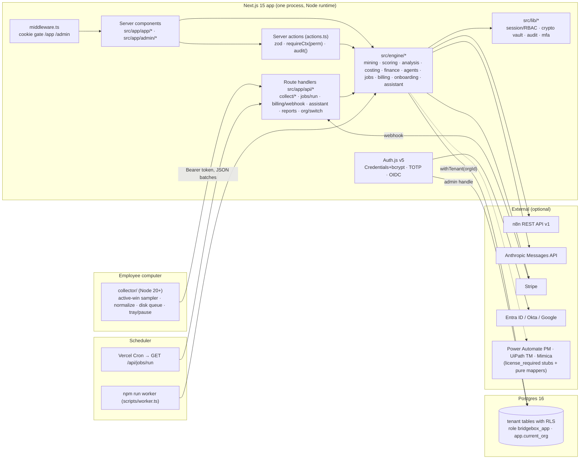

# Architecture

Plain description of how BridgeBox AI Workforce Intelligence is put together. File paths are the source of truth;
where this document and the code disagree, the code wins and this document is wrong.

## 1. Components



Everything server-side lives in one Next.js process (plus an optional worker process for self-hosting). There is no
separate API service, message broker or cache; the `jobs` table is the queue.

## 2. Request flow

### Page request (`/app/opportunities/[id]`)
1. `src/middleware.ts` checks for an `authjs.session-token` cookie and redirects to `/login?next=…` if absent. This is
   UX only; it proves nothing.
2. The server component calls `requireCtx("opportunities:read")` (`src/lib/session.ts`): Auth.js resolves the JWT,
   `getCtx()` loads the user's memberships, picks the active org from the `bb_org` cookie (falling back to the first
   membership, or to a managed client org when the user belongs to its parent consultancy), and `can(role, perm)`
   checks the RBAC matrix. Failure redirects to `/login` or `/app?denied=<perm>`.
3. Data loads inside `withTenant(ctx.orgId, tx => …)` (`src/db/tenant.ts`): a transaction that sets
   `app.current_org` and switches to the non-superuser role `bridgebox_app`, so Postgres RLS enforces `org_id =
   app_current_org()` on every statement, in addition to the explicit `where orgId = …` the code also writes.
4. The page passes plain JSON to a `"use client"` component for interactivity.

### Mutation (server action)
`"use server"` function in the page's `actions.ts` → zod-parse the input → `requireCtx(perm)` → `withTenant` write →
`audit({ orgId, actorUserId, action, entityType, entityId, details })` → `revalidatePath`. `orgId` is never taken from
the request.

### API route
`requireApiCtx(perm)` returns a 401/403 `Response` instead of redirecting; otherwise identical. Collector routes use a
bearer token instead of a session (see §7).

## 3. Tenancy model

| Layer | Mechanism | Where |
|---|---|---|
| Database | RLS policy `tenant_isolation` (`USING org_id = app_current_org() WITH CHECK …`) on 24 tenant tables, `org_self` on `organizations` (own org or children), `users_in_org`, `audit_org`, `jobs_org`. `FORCE ROW LEVEL SECURITY` so even the table owner is subject to it when running as `bridgebox_app`. | `drizzle/rls.sql`, applied by `scripts/migrate.ts` after every migration |
| Application | `withTenant(orgId, fn)` sets the session variable and role inside one transaction; the `orgId` comes from `requireCtx()`, never from input. The admin handle `db` (`src/db/client.ts`, bypasses RLS as the connecting superuser/owner) is allowed only in auth, collector-token lookup, Stripe webhook org resolution, the job runner, seed and tests. | `src/db/tenant.ts`, `src/db/client.ts`, `docs/CONVENTIONS.md` |
| Consultancy → client | `organizations.kind = consultancy` with client orgs pointing at it via `parent_org_id`. A consultancy owner/admin/consultant may switch into any child org (`/api/org/switch` validates against `listUserOrgs`) and is then treated as role `consultant` inside that org — still inside `withTenant(clientOrgId)`. The portal pages (`/admin/*`) read across clients with the admin handle only after `assertClientOfConsultancy` (`src/engine/onboarding.ts`). | `src/lib/session.ts`, `src/app/api/org/switch/route.ts` |
| Employee self-scope | `memberships.employee_id` links a login to an employee row; the Trust page and `self:read` use it. | `src/app/app/trust/*` |

Proof: see `docs/SECURITY.md` §5 for the exact tests.

## 4. Data model (summary)

`src/db/schema.ts`, 28 tables. Every tenant table has `org_id`. Numeric columns are `numeric` (strings in JS — wrap
with `num()`). Money and hours carry a `basis` and, for money, a `CalcTree` JSON.

| Group | Tables | Notes |
|---|---|---|
| Tenancy & identity | `organizations`, `users`, `memberships`, `invitations` | `organizations.settings` (financial defaults), `branding`, `retention_days`, `is_demo`; `users.password_hash`, `mfa_secret_enc` (vault-encrypted), `sso_subject` |
| People | `departments`, `employees` | `base_annual_cost`, `loaded_hourly_cost`, `cost_basis`; cost columns gated by `employees:cost:read` |
| Consent & collection | `consent_records`, `authorizations`, `collectors`, `observation_campaigns`, `activity_events` | events are metadata only (`app`, `app_category`, `title_category`, `title_hash`, `duration_ms`, numeric `meta`); `collectors.token_hash` = sha256 of the bearer token |
| Analysis | `workflows`, `workflow_employees`, `analysis_runs`, `opportunities` | steps, process map, evidence, scores, flags, economics tree |
| Agents | `credentials` (AES-256-GCM blobs), `agents`, `agent_runs`, `approvals` | run ledger feeds verified savings |
| Finance | `savings_measurements`, `financial_models`, `projects`, `reports` | `reports.pdf_bytes` base64 in-row (known limitation) |
| Billing | `subscriptions`, `invoices` | Stripe ids, plan, seats, agent slots |
| Platform | `integrations`, `audit_log`, `jobs` | `jobs` is the queue; `audit_log` is append-only for the app role |

## 5. Engines (the pipeline)

```
collector → ingest → analysis (mining → scoring) → opportunities → finance → agents → measurement → reports
```

| Stage | Module | Input → output |
|---|---|---|
| Collector | `collector/src/*` | foreground window samples → `WireEvent[]` (app, category, salted title hash, duration, counts) |
| Ingest | `src/app/api/collect/*`, `_lib.ts` | bearer auth, rate limit, authorization / consent / campaign-window gates, blocked apps, `titleMode` → `activity_events` rows |
| Mining | `src/engine/mining.ts` | one employee's events → sessions → task instances → clusters (Jaccard + LCS) → workflow metrics and process maps |
| Scoring | `src/engine/scoring.ts` | metrics → repetition / automation scores, judgment & regulatory flags, duplicate detection, opportunity type and agent category, feasibility, risk, rank |
| Analysis orchestration | `src/engine/analysis.ts` → `runAnalysis({orgId, campaignId})` | loads events per employee inside `withTenant`, replaces `workflows` and `identified` opportunities, preserves in-flight opportunities by step-signature matching, writes `analysis_runs.summary` |
| Costing | `src/engine/costing.ts` | the only place with money formulas: `loadedHourlyCost`, `opportunityEconomics`, `SCENARIOS`, `threeYearProjection`, `DEFAULTS`, `IMPLEMENTATION_PROFILES` |
| Finance | `src/engine/finance.ts` | `computeOrgFinancials` (org / department / employee roll-ups, scenarios), `recordSavingsFromRunLedger`, `generateExecutiveReport` (pdfkit) |
| Agents | `src/engine/agents/*` | `templates.ts` (catalog by category, 4 with real n8n JSON), `definition.ts` (zod node graph), `runner.ts` (internal runtime: trigger/transform/condition/http/action+compensate/llm/approval/notify/end, retries, rollback, redaction), `n8n.ts` (push/activate/trigger/import executions), `measure.ts` |
| Measurement | `measure.ts` → `finance.ts` | run ledger minutes × hours-weighted loaded hourly → `savings_measurements` (basis observed); before/after observation on the linked workflow |
| Reports | `finance.ts` `generateExecutiveReport` | `executive_roi`, `investment_proposal`, `monthly_performance` PDFs with cover, headline numbers, departments, top-10, scenarios, 3-year table, assumptions, methodology, demo watermark |
| Assistant | `src/engine/assistant.ts` | builds a role-filtered evidence pack, answers deterministically by intent matching (default) or via Anthropic with the model restricted to the pack; every answer cites entities |
| Onboarding / billing | `onboarding.ts`, `billing.ts` | client org creation with trial, CSV employee import, invitations; plans, Stripe checkout/portal/webhook, seat enforcement |

Details: `docs/ANALYSIS_METHOD.md`, `docs/FINANCIAL_METHOD.md`, `docs/INTEGRATIONS.md`, `docs/BILLING.md`.

## 6. Job queue

`src/engine/jobs.ts` over the `jobs` table. `enqueue(kind, payload, orgId?, runAfter?)`; `runPending({limit})` claims
with `SELECT … FOR UPDATE SKIP LOCKED`, runs the registered handler, and on failure reschedules with
`backoffMs(attempt) = min(1 h, 30 s × 2^(attempt−1))` up to `max_attempts` (default 3). `requeueStale()` returns
`running` rows older than 30 minutes to `queued`.

Registered kinds: `retention_sweep`, `collector_offline_check`, `analysis` (built in), `agent_run` (registered by
`src/engine/agents/runner.ts` when it is imported), and `stripe_event` rows used purely as an idempotency ledger.

Two ways to tick it:
- **Vercel Cron** → `GET /api/jobs/run` every 5 minutes (`vercel.json`), authenticated with `CRON_SECRET`
  (`x-cron-secret` header or `Authorization: Bearer`). Each tick also enqueues housekeeping if none is pending and runs
  up to `?limit=` (default 10, max 50) jobs within the route's 60 s `maxDuration`.
- **Self-hosted worker** → `npm run worker`, polls every `WORKER_POLL_MS` (5 s), enqueues the offline check every
  5 minutes and the retention sweep hourly. Multiple instances are safe.

Caveat: the `analysis` handler on the synthetic 20-day org takes seconds, but a large client could exceed Vercel's
function timeout; run the worker (or a dedicated job host) for big tenants.

## 7. Collector protocol and gates

`src/collector-protocol/schema.ts` is the single zod definition shared by both sides. Enrollment exchanges a one-time
code (7 days, one use, 20 req/min per IP) for a bearer token stored only as `sha256` on the server. Every event batch
passes three server-side gates — signed authorization on file, an acknowledged, non-withdrawn consent record (the ingest gate checks the latest record's acknowledged/withdrawn state; it does not compare the notice version — the UI does, see `docs/PRIVACY.md` §3),
timestamp inside a `running` campaign window and schedule in the org's time zone — then blocked-app filtering and
`titleMode` reduction, before a single multi-row insert inside `withTenant`. See `docs/COLLECTOR.md`.

## 8. Integration adapters

| Adapter | Pattern | Status in this build |
|---|---|---|
| n8n (`agents/n8n.ts`) | Real REST v1 calls (`X-N8N-API-KEY`); config from env or an `integrations` row + vault credential; executions imported into `agent_runs` idempotently | built; request shapes unit-tested with mocked `fetch`; no live server in CI |
| Anthropic (`agents/runner.ts` llm node, `assistant.ts`) | `POST /v1/messages`, `claude-sonnet-4-5`, 60 s timeout, retry on 429/5xx | built; only the unconfigured path is tested |
| Stripe (`billing.ts`) | Checkout, Portal, webhook signature verification, idempotent event handling | built; mocked client in tests |
| OIDC (`lib/auth.ts`) | generic Auth.js OIDC provider, JIT user creation | built; never exercised against a provider |
| Power Automate / UiPath / Mimica (`adapters/process-mining.ts`) | `ProcessMiningAdapter` interface; `status()` → `license_required`; `importProcesses()` throws `NotConfiguredError`; pure mappers from each vendor's export shape to `workflows` rows | mappers unit-tested; no live API |

Rule from `docs/CONVENTIONS.md`: never fake a success. Unconfigured integrations say so in the UI with the exact env
var or license needed.

## 9. Build vs. buy — and why

| Capability | Decision | Reason |
|---|---|---|
| Desktop activity capture | **Build** (`collector/`) | The only way to guarantee the privacy contract: metadata only, no input hooks, salted hashes on-device, blocked-app list enforced before sampling, employee pause, open protocol the client's IT can audit. Vendor task-mining agents record screenshots/keystrokes and are priced per user; we would be reselling a black box and inheriting its privacy posture. Cost: we own Windows/macOS packaging, signing and MDM rollout (see roadmap). |
| Process / task mining analytics | **Build** core (`mining.ts`, `scoring.ts`) + **licensed adapters** for Power Automate Process Mining, UiPath Task Mining, Mimica | Our engine runs on our metadata-only events, which the vendors cannot ingest. Clients who already own a vendor license get a mapper that imports their exports into the same `workflows` table so the scoring and finance layers apply unchanged. Live vendor APIs need licenses we do not hold, so those adapters are honest `license_required` stubs. |
| Agent runtime | **Build** a small internal runtime + **n8n** (open source, self-hostable) as the production runtime | The internal runtime exists so approvals, redaction, compensation and the run ledger are under our control and testable offline. n8n gives 400+ connectors, credential storage and a UI the client's IT already understands, under a Sustainable Use License that permits self-hosting for free. Templates ship as n8n JSON. |
| LLM | **Buy** (Anthropic Messages API) | Commodity; wrapped so it is optional and never fakes output. |
| Auth | **Buy** Auth.js (library) + optional customer IdP via OIDC | Not a differentiator; SSO is a procurement checkbox. |
| Billing | **Buy** Stripe | Same. |
| PDF reports | **Build** on pdfkit | Full control over the layout, watermarking and the calculation tree rendering; no external document service sees client financials. |
| Queue | **Build** on Postgres (`jobs` table) | One fewer moving part at this scale; `SKIP LOCKED` is enough until there are many concurrent workers. |

## 10. Technology choices and alternatives rejected

| Choice | Rejected | Why |
|---|---|---|
| Next.js 15 App Router, server components + server actions | separate SPA + REST/GraphQL API (NestJS/Express) | One deployable, typed end to end, data loads server-side inside `withTenant`; nothing tenant-scoped ever reaches the browser without passing `requireCtx`. The cost is Vercel-shaped constraints (function timeouts) that the worker mode offsets. |
| Postgres 16 + RLS | application-level scoping only; one database per tenant | RLS makes a missed `where orgId` a non-event; database-per-tenant multiplies migrations and cost for a consultancy running dozens of small clients. |
| Drizzle ORM | Prisma | SQL-shaped, works inside explicit transactions with `set_config` (needed for RLS), no engine binary, fast cold starts. |
| Auth.js v5 (JWT sessions) | Clerk/Auth0, database sessions | No per-MAU vendor fee; JWT keeps page loads database-free for auth; 12 h max age; revocation is a known gap (§SECURITY). |
| Tailwind v4 + own primitives | component library (MUI, shadcn) | Small surface, consistent `data-testid` discipline, no dependency churn. |
| Recharts | D3 by hand, Chart.js | Declarative, SSR-safe, enough for four chart types. |
| pdfkit | Puppeteer/HTML-to-PDF | No headless browser in serverless; deterministic output; smaller. |
| Vitest against real Postgres | mocked DB | The isolation and RLS behaviour is the product; mocks would not prove it. |
| Playwright | Cypress | Multi-context (four roles in one test), request fixtures for the collector protocol, mobile emulation. |
| Node collector on `active-win` | Electron app, native C++/Swift agents, vendor agent | Smallest footprint and dependency surface that can read the foreground window on both platforms; packagable to a single binary. Weakness: unsigned and untested on real desktops in this build. |
